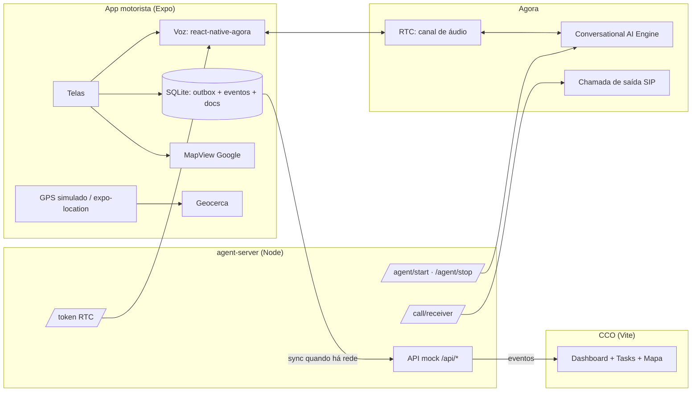
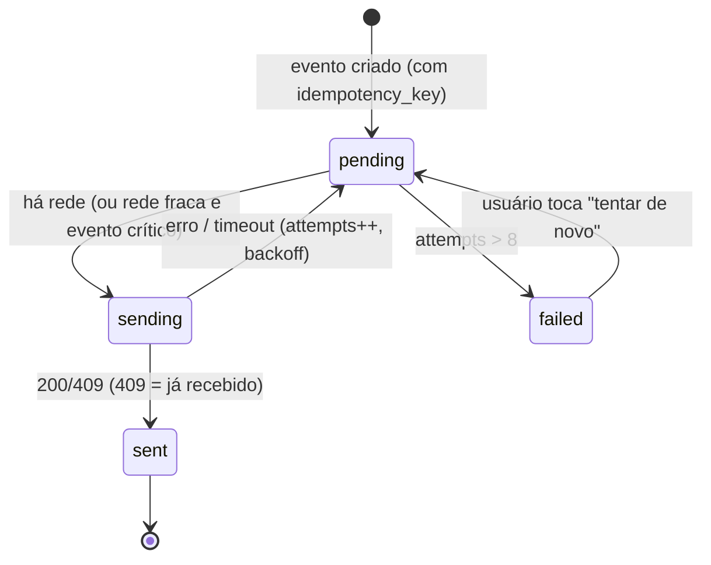
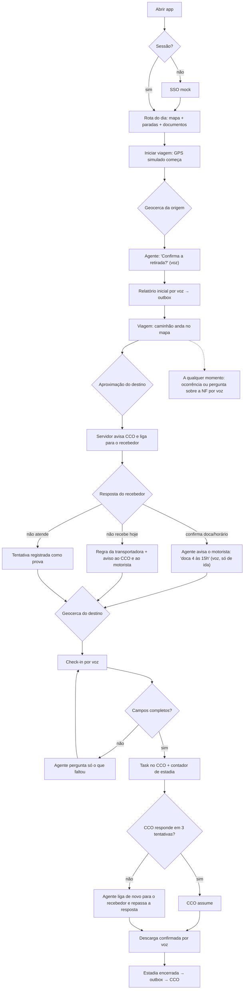
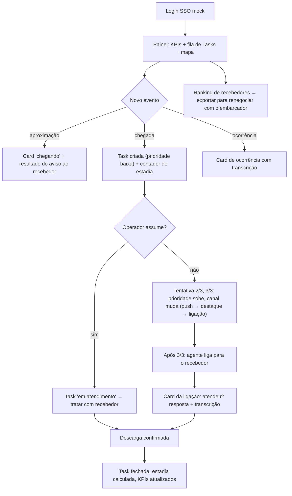

# AvisAI — Arquitetura, design e fluxos (plano inicial de implementação)

> **Plano inicial, substituído pela implementação.** O código real está em [rodar-backend](https://github.com/rodarglobal/rodar-backend) (FastAPI + Postgres, **não** o `agent-server` em Node descrito abaixo), [rodar-web](https://github.com/rodarglobal/rodar-web) e [rodar-mobile](https://github.com/rodarglobal/rodar-mobile). AvisAI virou o nome do agente de voz do RODAR. A referência vigente de produto e arquitetura é [`RODAR-CONTEXT.md`](../RODAR-CONTEXT.md). O posicionamento (integração, dashboard e três dores) está no [ADR-0001](adr/0001-integracao-setup-e-tres-dores.md). Este arquivo fica como histórico de design (tokens visuais, estados da voz, fluxos de tela).

22/11/2026 · Mobile (Expo / React Native) + CCO web (React + Vite) + servidor do agente (Node). Tudo mockado, **menos a voz pela Agora**.

## 0. Regras do plano

1. **Mock em tudo, menos na Agora.** Rota, GPS, recebedores, documentos, SSO, TMS e métricas são mock. A conversa por voz (Conversational AI Engine) é real. Tudo o que é mock vai declarado no README (E8).
2. **Chaves fora do app e do git** (segurança). App ID/certificado da Agora, chave REST, chave do Google Maps e credenciais do SIP ficam em `.env` (há `.env.example` com os nomes). O app nunca chama a API REST da Agora direto: quem chama é o `agent-server`.
3. **Cortes por prioridade.** P0 entra na demo de qualquer jeito; P1 entra se P0 estiver pronto às 4h00; P2 só depois da gravação do vídeo.

| Prioridade | Mobile | CCO web | Servidor |
|---|---|---|---|
| **P0** | Login mock, rota no mapa, GPS simulado, sessão de voz Agora (microfone), check-in com campo faltante | Fila de Tasks + KPIs + timeline de eventos | `/agent/start`, `/agent/stop`, token RTC, eventos mock |
| **P1** | Fila offline (outbox) com indicador de rede, aviso de aproximação | Mapa da frota, ranking de recebedores, contador de estadia | Ligação ao recebedor (SIP) ou plano B (2º cliente RTC) |
| **P2** | Visualizador de PDF + perguntas sobre o documento (busca vetorial local) | Gráficos de tendência, filtro por período | — |

## 1. Visão do sistema



## 2. Repositório (monorepo pnpm)

```
avisai/
├── apps/
│   ├── mobile/            # Expo (dev build) + NativeWind
│   ├── cco-web/           # React + Vite + Tailwind
│   └── agent-server/      # Node (Express ou Hono): Agora REST, token, mock API
├── packages/
│   ├── tokens/            # preset Tailwind compartilhado (cores, tipografia, raios)
│   ├── i18n/              # locales pt-BR e en por namespace (= feature)
│   └── contracts/         # tipos de eventos e entidades (TypeScript)
├── .env.example
└── README.md              # como rodar, dependências, mocks declarados, versão (tag)
```

Os dois apps seguem a mesma arquitetura **feature/domínio**:

```
src/
├── app/          # providers (i18n, query, tema, auth), navegação, store global
├── assets/
├── components/   # UI genérica: Button, Card, Badge, Sheet, Toast, NetworkBanner
├── features/
│   └── <feature>/
│       ├── api/         # chamadas e hooks de dados (react-query)
│       ├── components/
│       ├── hooks/
│       ├── types/
│       └── index.ts     # exportação pública da feature
├── hooks/        # useNetwork, usePermissions, useInterval
├── lib/          # http (fetch com base URL), db (SQLite), i18n, agora
├── pages/        # telas montadas a partir das features
├── services/     # integrações externas compartilhadas (agora, maps, sync)
├── types/
└── utils/        # funções puras: distância, cosseno, formatação
```

> No mobile, usar **React Navigation** (não Expo Router): o Expo Router exige as rotas em `app/`, o que conflita com o `app/` de configuração global desta estrutura.

## 3. Design system (inspirado na Agora)

Cor principal: azul da Agora **#099DFD** (cor oficial da marca, via Simple Icons). Superfícies escuras como no site da Agora. O produto é **AvisAI**: usar o selo "Powered by Agora" só conforme as regras de marca da Agora, nunca o logo como se fosse nosso.

| Token | Valor | Uso |
|---|---|---|
| `brand-500` | `#099DFD` | ações primárias, links, mic ativo |
| `brand-600` | `#0780D0` | pressionado |
| `brand-50` | `#E6F5FF` | fundos de destaque (tema claro) |
| `ink-950` | `#0B1220` | fundo do app (tema escuro, padrão no mobile) |
| `ink-900` | `#121A2B` | cards |
| `ink-700` | `#2A3550` | bordas |
| `ink-300` | `#A7B1C6` | texto secundário |
| `ink-50` | `#F4F6FA` | texto principal no escuro / fundo no claro |
| `wait-500` | `#F5A524` | espera, estadia correndo |
| `alert-500` | `#F04438` | escalonamento, não atendeu |
| `ok-500` | `#17B26A` | confirmado, descarga |

- **Tipografia:** Inter (texto) e Space Grotesk (números grandes do dashboard e do contador). Escala: 12 / 14 / 16 / 20 / 28 / 40.
- **Raios:** 8 (inputs), 12 (cards), 999 (botão do microfone e badges).
- **Estados da voz** (o centro da experiência): `idle` (anel cinza) → `listening` (anel `brand-500` pulsando) → `thinking` (três pontos) → `speaking` (onda) → `interrupted` (flash breve ao detectar barge-in). Sempre com legenda em texto, não só cor.
- **Rede:** banner fixo no topo — "Sem conexão · 3 eventos na fila" (`wait-500`) / "Sincronizado" (`ok-500`, some em 2 s).

`packages/tokens/tailwind-preset.js` exporta `theme.extend` com esses tokens. O mobile usa via **NativeWind** (`presets: [require('@avisai/tokens')]`) e o web via `tailwind.config` com o mesmo preset.

## 4. i18n

- `i18next` + `react-i18next` nos dois apps; `expo-localization` no mobile para detectar o idioma.
- Idiomas: `pt-BR` (padrão) e `en` (júri e público internacional).
- Um namespace por feature (`auth`, `route`, `voice`, `report`, `arrival`, `documents`, `outbox`, `tasks`, `metrics`) em `packages/i18n/locales/<lang>/<ns>.json`.
- Texto falado pelo agente **não** passa pelo i18n do app: vem do prompt do agente (idioma do LLM/TTS).

## 5. Mobile (Expo)

### 5.1 Requisito de build

`react-native-agora`, `react-native-maps` com Google e `react-native-pdf` são módulos nativos: **não rodam no Expo Go**. Fazer um **dev build** (`expo-dev-client` + EAS ou `expo run:android`) na primeira hora. Android primeiro: é o celular do caminhoneiro e o build é mais rápido.

### 5.2 Features

| Feature | O que faz | Bibliotecas | Mock |
|---|---|---|---|
| `auth` | SSO genérico: botão "Entrar com SSO" → tela fake do provedor → token | `expo-auth-session` (pronto para OIDC real), `expo-secure-store` | provedor e usuário mock no `agent-server` |
| `route` | Rota do dia, paradas, mapa com a polilinha e o caminhão andando | `react-native-maps` (`PROVIDER_GOOGLE`, chave via `app.config.ts`) | rota e recebedores em JSON |
| `location` | Posição, geocerca de origem/destino, aproximação (X min antes) | `expo-location` (permissão) + **simulador** que percorre a polilinha em tempo acelerado | GPS do celular e "rastreador" simulados |
| `voice` | Sessão com o agente: entrar no canal, microfone, estados de voz, transcrição na tela | `react-native-agora`, permissão de microfone (`expo-av` ou `expo-audio`) | **real** (Agora) |
| `report` | Reporte com campos obrigatórios; o agente pergunta só o que faltou | regras da rota | campos e regras mock |
| `arrival` | Check-in por voz, contador de estadia, aviso "o recebedor confirmou doca 4 às 15h" | — | resposta do recebedor mock (ou SIP real) |
| `documents` | Lista e leitura da NF/CT-e em PDF; pergunta por voz sobre o documento | `react-native-pdf` + `react-native-blob-util` | PDFs fictícios em `assets/` |
| `outbox` | Fila offline: tudo o que sai do app passa por aqui | `expo-sqlite`, `@react-native-community/netinfo` | — |

### 5.3 Dados locais (SQLite)

```sql
-- fila de saída (offline-first)
outbox(id TEXT PK, type TEXT, payload JSON, idempotency_key TEXT UNIQUE,
       status TEXT CHECK(status IN ('pending','sending','sent','failed')),
       attempts INT DEFAULT 0, next_try_at INT, created_at INT)

-- espelho local dos eventos da viagem (a tela lê daqui, não da rede)
events(id TEXT PK, trip_id TEXT, type TEXT, payload JSON, occurred_at INT, synced INT)

-- busca vetorial local (P2)
documents(id TEXT PK, trip_id TEXT, kind TEXT, title TEXT, file_uri TEXT)
chunks(id TEXT PK, document_id TEXT, text TEXT, embedding BLOB)  -- Float32Array
```

**Banco vetorial local, versão do MVP:** os embeddings dos PDFs mock são **pré-calculados** e vêm num JSON junto com o app; no primeiro uso vão para `chunks`. A busca é cosseno em JS sobre os chunks da viagem (dezenas de linhas, roda em milissegundos). A extensão `sqlite-vec` fica para depois: é mais rápida, mas custa tempo de build que não temos. A pergunta do motorista vira embedding pelo mesmo modelo no `agent-server` (ou, no mock, por palavra-chave) e os 3 melhores trechos vão como contexto para o agente, que responde citando o documento ou diz "não encontrei".

### 5.4 Offline-first (fila de mensagens)

- **Toda escrita** (reporte, ocorrência, check-in, descarga) vira linha no `outbox` com `idempotency_key` (UUID) e aparece na tela na hora, a partir de `events`.
- **Rede boa / fraca / sem rede:** `NetInfo` dá conectado ou não; "fraca" = ping ao `agent-server` acima de 1,5 s ou 2 falhas seguidas. Com rede fraca, a fila só manda eventos críticos (chegada, ocorrência) e adia o resto.
- **Envio:** em ordem de criação, um por vez, com retry exponencial (2 s, 4 s, 8 s… até 60 s). O servidor ignora `idempotency_key` repetida, então reenviar não duplica.
- **Voz sem rede:** a Agora precisa de internet. Sem rede, o app troca para modo texto e grava o pedido na fila ("vou avisar o CCO assim que voltar o sinal"). Isso é a recuperação de falha.



### 5.5 Fluxo de operação no app



## 6. CCO web (React + Vite)

### 6.1 Features

| Feature | Tela | Fonte (mock) |
|---|---|---|
| `auth` | login SSO mock | `agent-server` |
| `tasks` | fila de Tasks por prioridade, tentativas (1/3, 2/3, 3/3), botão "assumir" | eventos |
| `fleet` | mapa com os caminhões (Google Maps JS via `@vis.gl/react-google-maps`) | posições simuladas |
| `trips` | timeline da viagem: retirada → aproximação → aviso ao recebedor → chegada → descarga | eventos |
| `receivers` | ranking: espera média, ligações atendidas, estadia devida | agregação dos eventos |
| `metrics` | KPIs e gráficos | agregação dos eventos |
| `calls` | log das ligações do agente ao recebedor, com a transcrição | eventos |

Bibliotecas: `react-router`, `@tanstack/react-query`, `zustand`, `recharts`, `i18next`, **MSW** para servir a API mock no próprio navegador (o dashboard roda até sem o servidor). Os eventos chegam por polling de 2 s no mock; se sobrar tempo (P2), por **Agora Signaling**, o que deixa a Agora visível também no CCO.

### 6.2 Métricas do dashboard (as que o agente consegue medir)

| KPI | Cálculo | Por que importa |
|---|---|---|
| Horas paradas por entrega | descarga − chegada, média | é o número do pitch |
| Estadia devida × cobrada (R$) | horas acima da franquia × t × R$ 2,50 | dinheiro na mesa |
| Tempo de espera por recebedor (TMD) | média por recebedor | ranking e renegociação com o embarcador |
| % de recebedores avisados antes da chegada | eventos `ReceiverNotified` / entregas | condição para a estadia (decisão do TJMT) |
| % de ligações ao recebedor atendidas | `ReceiverCallResult.answered` | qualidade do contato |
| Tempo até ação do CCO | `TaskAcknowledged` − `TaskCreated` | gargalo da central |
| Tasks escaladas (3 tentativas) | contagem | onde o CCO falha |
| % de reportes completos na 1ª resposta | reportes sem pergunta de complemento | qualidade da voz |
| Ligações CCO ↔ motorista evitadas | contatos resolvidos pelo agente | ganho de capacidade do CCO |
| Latência da voz (p50/p95) | fim da fala → início da resposta | experiência de voz |

### 6.3 Fluxo de operação no CCO



## 7. Contratos de eventos (`packages/contracts`)

```ts
type EventType =
  | 'RouteAssigned' | 'PickupConfirmed' | 'ReportSubmitted' | 'ReportFieldMissing'
  | 'OccurrenceCreated' | 'ApproachDetected' | 'ReceiverNotified' | 'ReceiverCallResult'
  | 'ArrivalRegistered' | 'TaskCreated' | 'TaskEscalated' | 'TaskAcknowledged'
  | 'UnloadConfirmed' | 'DocumentQuestionAnswered';

interface DomainEvent<T = unknown> {
  id: string;               // UUID
  idempotencyKey: string;   // o mesmo do outbox
  tripId: string;
  type: EventType;
  occurredAt: string;       // ISO, hora do celular
  receivedAt?: string;      // hora do servidor (prova)
  source: 'driver' | 'agent' | 'cco' | 'system';
  payload: T;
}
```

## 8. agent-server (Node)

| Rota | Faz | Real ou mock |
|---|---|---|
| `POST /agent/start` | chama `POST /api/conversational-ai-agent/v2/projects/:appid/join` (auth Basic) com canal, token do agente, ASR, LLM, TTS e o prompt do AvisAI | **real** |
| `POST /agent/stop` | encerra o agente | **real** |
| `GET /token?channel&uid` | gera token RTC | **real** |
| `POST /call/receiver` | chamada de saída SIP da Agora; plano B: abre canal para um 2º cliente RTC fazendo o recebedor | real ou plano B declarado |
| `POST /events`, `GET /events` | recebe o outbox (idempotente) e serve o dashboard | mock (memória) |
| `GET /api/route`, `/api/receivers`, `/api/documents` | dados da viagem | mock (JSON) |
| `POST /auth/sso` | devolve token fake | mock |

**Primeiro teste da noite:** português no ASR. A página de exemplo da Agora mostra `en-US`; confirmar o código de idioma `pt-BR` no fornecedor de ASR escolhido antes de qualquer tela.

## 9. Plano de implementação do MVP (histórico)

| Hora | Pessoa A (voz + servidor) | Pessoa B (mobile) | Pessoa C (CCO web + design) |
|---|---|---|---|
| 0:00–1:00 | `agent-server` + `/agent/start` em pt-BR funcionando | monorepo, dev build Android, NativeWind, i18n | Vite + Tailwind + preset de tokens + MSW |
| 1:00–2:00 | prompt do agente: check-in, campo faltante, barge-in | login mock, mapa com rota e GPS simulado | fila de Tasks + KPIs com dados mock |
| 2:00–3:00 | SIP de saída (corte às 3:00 → plano B) | tela de voz (estados) + outbox + banner de rede | timeline e ranking de recebedores |
| 3:00–4:00 | ligar eventos reais da voz ao `/events` | aproximação → aviso → check-in → Task | mapa da frota + log de ligações |
| 4:00–4:30 | ensaio da demo, medir latência | correções | correções |
| 4:30–5:00 | **gravar o vídeo de 2 min** | README (como rodar, mocks, versão) | tag de versão, `check-rules.sh` |

PDF e busca vetorial (P2) só entram se o vídeo já estiver gravado.

## 10. Variáveis de ambiente (`.env.example`)

```
AGORA_APP_ID=
AGORA_APP_CERTIFICATE=
AGORA_REST_KEY=
AGORA_REST_SECRET=
SIP_TRUNK_ADDRESS=
SIP_FROM_NUMBER=
GOOGLE_MAPS_API_KEY_ANDROID=
GOOGLE_MAPS_API_KEY_WEB=
API_BASE_URL=http://localhost:8787
```

## 11. Declarações para o README (preexistente e simulado)

- **Simulado:** GPS e rastreador (trajeto gravado em tempo acelerado), rota, recebedores, documentos (PDFs fictícios), SSO, TMS, eventos do CCO e métricas (gerados), recebedor (pessoa do time ao telefone ou 2º cliente RTC).
- **Real:** conversa por voz pela Agora Conversational AI Engine (e a chamada SIP, se funcionar).
- **Preexistente:** bibliotecas listadas nas dependências; nenhum código anterior ao projeto.
