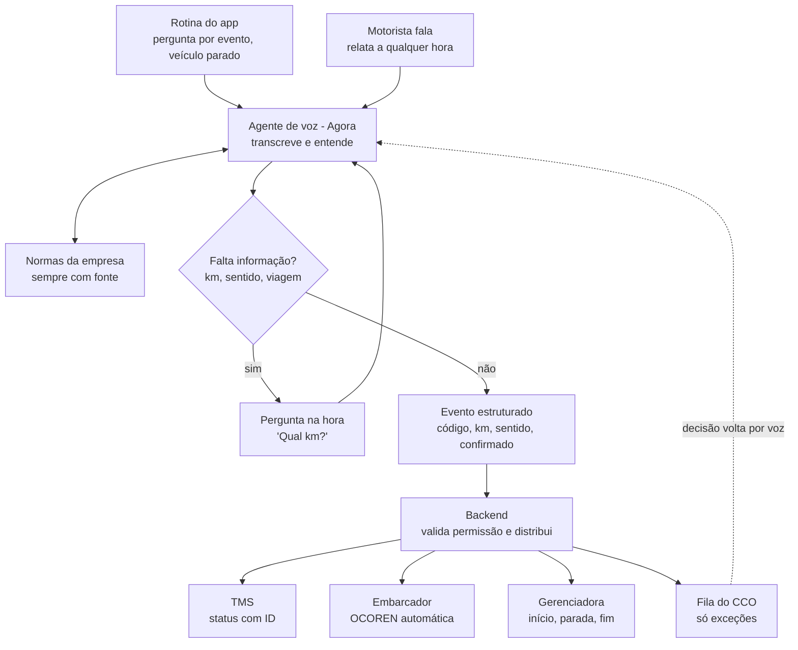

# Despacho por Voz

- **Autor(es):** Jeferson, Henry e Lucas (time Quarteto Chapahalls)
- **Status:** avaliada
- **Nota do judge:** 3,50 / 5 ([relatório](scores/despacho-por-voz.md)) — versão anterior desta ideia; reavaliar depois desta atualização

> O motorista relata uma ocorrência por voz, no app, uma vez; o agente pergunta o que faltou, transforma a fala em evento estruturado, distribui para TMS, embarcador e gerenciadora de risco, e o CCO só decide as exceções — com a resposta voltando por voz para o motorista.

**Problema que resolvemos:** o gargalo da comunicação manual entre a cabine e a central. Hoje tudo o que o motorista informa passa pela mão de um operador, que ouve, interpreta e redigita em vários sistemas.

Origem: retorno da mentoria (Terron / newhack, 21/11) — "escolham uma tarefa operacional repetitiva e demonstrem com segurança". É um recorte da ideia [`parceiro-de-estrada`](parceiro-de-estrada/README.md), focado só no fluxo motorista ↔ central.

**Para quem:** a transportadora média brasileira, inclusive a que não tem TMS. Integração por conectores prontos para o que é padrão (EDI Proceda, TMS mais comuns); engenheiro em campo só nos primeiros clientes (ver *Integração e implantação*).

## Problema e público (C3 · 20%)

- **Quem:**
  - Motorista de transportadora com CCO (usuário do app).
  - Operador / despachante do CCO (usuário do painel).
  - Gestor de operação (comprador).
  - TI (controla a integração).
- **Problema concreto:**
  - Quando há impedimento (cliente não descarrega, falta agendamento, espera sem previsão), o motorista liga para o CCO, espera atender, repete viagem/cliente/problema, ouve "vou ver e te retorno" e fica parado esperando orientação. O operador redigita tudo.
  - O motorista também se comunica por macros digitadas no teclado do rastreador, numa sequência fixa de estágios ([TOTVS/Open Tech](https://tdn.totvs.com/download/attachments/61210667/TMS_BT_Integracao%20com%20Rastreadores_Open%20Tech_TGLV65.pdf?api=v2), [Michelin KMS](https://connectedfleet.michelin.com/hubfs/MANUAL_KMS-v-4.2.0.pdf)), e por WhatsApp, com áudio, foto e texto solto.
  - Numa central real, o operador analisa o alerta e liga para o motorista; se ele não responde, aciona a gerenciadora de risco ([Movecta](https://mundologistica.com.br/noticias/movecta-implanta-central-controle-reduz-custos-operacoes-rodoviarias)).
- **Comunicações obrigatórias que o operador alimenta à mão:**

| Comunicação | Para quem | Como funciona |
|---|---|---|
| Ocorrência de entrega (EDI OCOREN) | Embarcador | Gerada pela transportadora para o cliente contratante; muitos embarcadores pedem com a sua própria tabela de códigos ([Proceda/Senior](https://documentacao.senior.com.br/gestaodefretesfis/7.0.0/arquivos/ocoren.pdf), [TranspNet](https://www.transp.net/blog/posts/ocorrencias-de-entrega-como-padronizar-tratar/)) |
| Status e etapas da viagem | TMS / torre de controle | Macros no rastreador com sequência fixa de estágios |
| Monitoramento de risco (SM) | Gerenciadora de risco | O TMS gera a solicitação e verifica se o motorista está habilitado ([Senior/Krona](https://documentacao.senior.com.br/gestaodetransportestms/3.34/tms/cce/smp-gerenciadora-de-risco/gerar-smp-krona.htm)) |
| Encerramento do MDF-e, inclusão de condutor | SEFAZ | Obrigatórios ([TranspNet](https://www.transp.net/blog/posts/cancelar-encerrar-mdfe-tutorial-completo/), [Contmatic](https://simplifique.contmatic.com.br/blogs/encerramento-de-mdfe-como-encerrar-prazo-2026)) — **fora do escopo do agente** (ver decisões) |

- **Complexidades de hoje:**
  - Dados espalhados em planilhas, ERPs, WhatsApp e sistemas desconectados, com retrabalho ([TranspNet](https://www.transp.net/blog/posts/torre-de-controle-logistico/)).
  - Texto livre em vez de código fechado de ocorrência, com responsável e prazo.
  - Regras de eventos fiscais diferentes por estado ([ANTT](https://www.gov.br/antt/pt-br/assuntos/cargas/transporte-multimodal-de-cargas/trabalhos-publicados-pela-antt/webinar-antt-impactos-da-reforma-tributaria-multimodal-marcelo-czaya.pdf/@@download/file)).
  - Consulta manual a normas e procedimentos da empresa (avaria, recusa, parada não autorizada). Sem dado público de tempo gasto — perguntar nas entrevistas.
- **Referência de mercado:** 28 motoristas por despachante numa transportadora dos EUA ([MIT CTL 2021](https://dspace.mit.edu/bitstream/handle/1721.1/130951/Procter_Sousa_Jr_project_Goldilocks_and_the_Three_Dispatchers.pdf)); hora de caminhão em operação a US$ 90,89 em 2024 (ATRI, via [levantamento 2026](https://ainora.lt/blog/transport-logistics-dispatch-call-statistics-2026)). Números de "% do dia do despachante ao telefone" circulam sem estudo por trás (mesmo levantamento) — não usar.
- **Falta medir no Brasil:** tempo do relato até a orientação e interações por ocorrência.
- **Benefício:**
  - Motorista: relata uma vez e sai do impasse mais rápido.
  - Operador: recebe só exceções, já estruturadas; decide com um clique.
  - Empresa: OCOREN, status e eventos de risco saem do mesmo registro, sem redigitar.

## Por que voz (C4 · 15%)

O WhatsApp entrega áudio; o agente entende o áudio. A voz aqui não é "falar em vez de digitar": é um agente que **pergunta o dado que faltou**, **transforma a fala em código de ocorrência**, **só confirma depois que a API aceita**, **consulta a norma da empresa citando a fonte** e **traz a decisão do despacho de volta** por voz. O motorista é o único ator da operação que não pode parar para preencher formulário.

## Fluxo de operação



- **Rotina do app:** pergunta por **evento**, não por relógio: entrada na área do cliente, parado há mais de 15 min, atraso sobre o previsto. Só pergunta com o veículo parado.
- **Canal:** só o app (sem WhatsApp). _(sugestão)_ No produto, a voz pode ser embutida como SDK no app que o motorista já usa (app de entrega/comprovante da transportadora), em vez de um app novo.

## A conversa (C1 · 25%)

```
Motorista: Cheguei no cliente, mas não descarregam hoje, falta agendamento.
Agente:    Viagem 4471, parada 2, Cliente X. Impedimento de entrega, falta de agendamento. Confirma?
Motorista: Confirma.
[backend verifica permissão → API sandbox responde OK, operação #A93 → OCOREN gerada]
Agente:    Registrado na operação A93 e avisado ao cliente. Peço orientação ao despacho?
Motorista: Pede. E o que eu faço com a nota enquanto isso?
Agente:    Pelo procedimento de recusa da empresa, item 4: mantém a nota com você e não descarrega. Já pedi a orientação.
[operador no painel clica "Ir para parada 3"]
Agente:    Despacho mandou seguir pra parada 3, Cliente Y. Confirma que recebeu?
Motorista: Recebi.
```

- **Interrupção (barge-in):** o motorista corta a confirmação ("não, é a 4475") e o agente para, troca a viagem e repete só o que mudou.
- **Falha e recuperação:**
  - Duas viagens parecidas → "Viagem 4471 ou 4475?"
  - API do TMS fora → registro fica "pendente"; ao voltar, reenvia com o mesmo identificador de operação (sem duplicar) e avisa o status. _(sugestão do judge: esta é a falha a mostrar ao vivo)_
  - Pedido sem permissão ("muda o destino", "encerra a ocorrência", "encerra o MDF-e") → "Isso só o despacho autoriza. Peço pra eles?" (permissão fora do modelo).
  - Informação inexistente ou norma não encontrada → "Não tenho essa informação. Pergunto ao responsável?"
  - O agente só diz "registrado" depois que a API devolve o identificador da operação.
- **Latência alvo:** _(sugestão)_ resposta < 1,5 s.

## Aplicações na operação

| Aplicação | Nasce na cabine? | Na demo? |
|---|---|---|
| Status: chegada, início/fim de descarga, bloqueio | Sim | **Sim** |
| Ocorrência: impedimento, avaria, mecânica | Sim | **Sim** |
| Consulta a normas e procedimentos (com fonte) | Sim | Sim, uma consulta |
| Documentos: status de CT-e/MDF-e (só consulta) | Sim | Não (slide) |
| Agendamento com destinatário (agente liga ao cliente) | Não | Não (slide) |
| Frete de retorno com autônomos | Não | Não (slide) |

## Decisões aceitas (mentoria e banca)

- **Orientação só com fonte:** o agente cita o procedimento da empresa; sem fonte, diz que não sabe e consulta o responsável. Não gera rota, previsão de chegada nem orientação de jornada como fato.
- **MDF-e fora do agente:** encerramento e inclusão de condutor são eventos fiscais; o agente pode avisar que a entrega terminou, mas quem executa é o TMS, com autorização.
- **Destinos simulados na demo:** TMS, OCOREN e gerenciadora rodam em sandbox identificada como simulação.
- **Cenário estacionário:** a demo é com o motorista parado (CTB art. 252; voz não elimina distração).
- **Sem inferência de fadiga pela voz.**

## 5 Porquês

**Problema observado:** o motorista fica parado esperando orientação, e o operador do CCO redigita cada ocorrência em vários sistemas.

| # | Por quê? | Resposta | Evidência | O que no fluxo ataca |
|---|---|---|---|---|
| 1 | Por que o motorista fica esperando e o operador redigita? | Porque o relato chega solto (ligação, áudio, texto) e o operador precisa interpretar antes de agir | Central real: operador analisa e liga para o motorista ([Movecta](https://mundologistica.com.br/noticias/movecta-implanta-central-controle-reduz-custos-operacoes-rodoviarias)) | Evento estruturado; fila do CCO só com exceções |
| 2 | Por que o relato chega solto? | Porque os canais não capturam o contexto (viagem, km, motivo): a macro é rígida e o WhatsApp é livre demais | Macros com sequência fixa ([Michelin KMS](https://connectedfleet.michelin.com/hubfs/MANUAL_KMS-v-4.2.0.pdf)) | Agente pergunta na hora o dado que faltou |
| 3 | Por que o motorista não manda completo? | Porque ele não pode preencher formulário (está dirigindo ou fora da cabine com a nota na mão), e cada sistema pede um formato | Cada embarcador com sua tabela de códigos ([TranspNet](https://www.transp.net/blog/posts/ocorrencias-de-entrega-como-padronizar-tratar/)) | Voz no app; motorista só confirma |
| 4 | Por que cada formato vira trabalho do operador? | Porque TMS, EDI do embarcador e gerenciadora não se falam, e não há camada que traduza um relato para todos | Dados em planilhas, ERPs, WhatsApp e sistemas desconectados ([TranspNet](https://www.transp.net/blog/posts/torre-de-controle-logistico/)) | Backend valida e distribui para TMS, OCOREN e gerenciadora |
| 5 | Por que não existe essa camada? | Porque a integração cabine ↔ sistemas foi feita para dados de máquina (GPS, macros), não para a linguagem do motorista; e integrar cada TMS sob medida é caro para a transportadora média | Hipótese — validar nas entrevistas com despachante e TI | Agente de voz + conectores prontos (EDI Proceda, TMS comuns) |

**Causa raiz:** falta uma camada que transforme a fala do motorista em evento validado, no formato que cada sistema exige, a um custo que a transportadora média pague.

**A validar nas entrevistas:** os porquês 3 e 5 (o motorista realmente não manda completo por falta de condição? a TI confirma que integrar é o custo que trava?).

## Aderência de mercado

**Frase da dor que dá para sustentar hoje (sem número inventado):**

> Toda ocorrência do motorista passa pela mão de um operador do CCO, que liga, interpreta e redigita em vários sistemas, muitas vezes a partir de um grupo de WhatsApp. E o motorista, para avisar, digita no rastreador dirigindo, com 23× mais risco ([`metricas.md`](parceiro-de-estrada/metricas.md), VTTI/FMCSA).

Depois das entrevistas, acrescentar: "X interações e Y minutos por ocorrência".

**Evidência de que a falta existe:**

| Achado | Fonte | Força |
|---|---|---|
| 23% das transportadoras não usam nenhum TMS; mais de 40% usam planilha para contratar autônomos | [TruckPad/Estradão/Ipsos](https://mundologistica.com.br/noticias/investimento-das-transportadoras-em-industria-40-ainda-e-pequeno-revela-estudo) | Setorial, **de 2018** — buscar número recente |
| Índice de produtividade tecnológica do setor logístico: 0,38 de 1; pouco uso de dispositivos móveis na operação | [TOTVS 2021](https://itforum.com.br/brandspaces/pesquisa-da-totvs-evidencia-oportunidades-de-ampliar-produtividade-tecnologica-do-setor-logistico-brasileiro/) | Fornecedor |
| Entrada de dados é o caso de IA mais citado (41%); só 5% das empresas com desempenho abaixo da média têm processos totalmente automatizados, contra 51% das melhores | [Descartes, 600+ empresas](https://mundologistica.com.br/noticias/gestao-transporte-diferencial-embarcadores-e-lsps) | Global |
| Monitoramento de uma transportadora feito por grupo de WhatsApp | [Fatec Bebedouro 2025](https://ric.cps.sp.gov.br/bitstream/123456789/39040/1/Logistica_2025-1_IgorSalvador_Relatoriodetranportesrodoviarios.pdf) | Caso real, uma empresa |
| Operador analisa o alerta e liga para o motorista; sem resposta, aciona a gerenciadora | [Movecta](https://mundologistica.com.br/noticias/movecta-implanta-central-controle-reduz-custos-operacoes-rodoviarias) | Caso real |

**Contra:** um estudo que propôs atualizar ocorrências de entrega em tempo real encontrou resistência cultural de transportadores e entregadores ([Fatec 2017](https://ric.cps.sp.gov.br/bitstream/123456789/26726/1/UPEP_Umsistemadegestaoaplicadaalogisticadedistribuicao_ValmirAdelinodeMoura_2017.pdf)). É o maior risco de adoção.

**Não usar:** tamanho do mercado global de TMS — as estimativas para o mesmo ano vão de US$ 9,71 bi a US$ 213 bi. Referência brasileira de tamanho: a Drivin Brasil (torre de controle e entregas) faturou R$ 7,3 mi em 2025, +61,5% ([Mundo Logística](https://mundologistica.com.br/noticias/drivin-brasil-cresce-projeta-expansao-sul)).

**Não achamos** produto brasileiro fazendo exatamente "fala do motorista → evento validado no formato do TMS/OCOREN" para a transportadora média. Isso não prova que não existe.

## Custo e preço

| Item Agora | Preço |
|---|---|
| Conversational AI Engine, tudo incluído (STT, LLM, TTS); mesmo preço com chave própria (BYOK) | US$ 0,10/min; primeiros 300 min grátis ([Agora, atualizado em 31/07/2026](https://docs.agora.io/en/ai/reference/pricing)) |
| Áudio RTC | US$ 0,00099/min (mesma fonte) |

**Custo por caminhão (conta nossa):** 4 interações/dia × 1,5 min × 25 dias = 150 min/mês; dólar a R$ 5,50.

| Configuração | Custo/caminhão/mês |
|---|---|
| Conversational AI (US$ 0,10/min) | ≈ R$ 82,50 |
| Áudio RTC (US$ 0,00099/min) | ≈ R$ 0,82 |
| **Total** | **≈ R$ 83** |

A configuração "Base + ARES" a US$ 0,0265/min (≈ R$ 22) não aparece mais na página de preços da Agora e saiu desta conta.

**Consequência:** o preço de R$ 30–40/caminhão não fecha. Preço adotado: R$ 100/caminhão/mês. A faixa de US$ 0,007–0,091/min do `metricas.md` é de vários fornecedores, não da Agora. Caminhos:
1. Preço de R$ 60–100/caminhão (faixa de rastreamento), justificado pelo retorno medido no piloto.
2. Poucos minutos por caminhão: os gatilhos por evento (não por relógio) também controlam custo.

## Reconciliação com as métricas do repositório

O repositório prova bem "o motorista fica sem sinal" (36,6% das federais com 4G da operadora do motorista) e "digitar dirigindo é perigoso" (23×). A dor central desta ideia — o gargalo manual no CCO — **ainda não tem medição**.

| Lacuna | Situação |
|---|---|
| Volume de mensagens e tempo do operador no CCO | Sem número; só indícios (acima). **Resolver com entrevistas** |
| Integração com ERPs/TMS | Há porta: EDI Proceda é o padrão mais usado ([Bsoft](https://bsoft.com.br/produtos/software-controle-transportadoras/edi-proceda)); Senior tem OCOREN configurável ([Senior](https://suporte.senior.com.br/hc/pt-br/articles/63983012%394484-TMS-EDI-OCOREN-Configur%C3%A1vel-Carregar-Ocorr%C3%AAncias-de-Entregas-do-CTe-para-o-arquivo-OCOREN-Configur%C3%A1vel)) e cita a WebAPI da SSW para ocorrências de parceiros ([Senior](https://documentacao.senior.com.br/gestaodetransportestms/3.33/manual-por-rotinas/edi/edi-webservice.htm)). Existe porta; não está provado que é fácil |
| Canhoto / faturamento | **Fora do escopo:** já há apps em que o motorista registra ocorrências e anexa canhotos ([Bsoft TNS](https://bsoft.com.br/tns-gestao-de-entrega)) |
| Starlink | **Fora do núcleo:** custa R$ 339–619/caminhão/mês e a Agora precisa de internet. Próximo passo: frota que já tem Starlink (Autotrac/Hughes) recebe o RODAR como software por cima |
| "A IA resolve 90% dos check-ins", "50% de zonas mortas" | Não usar (sem fonte). Usar "36,6% das federais com 4G da operadora do motorista" |

## Roteiro de entrevista com operadores de CCO (10 min)

Fazer hoje com 2–3 operadores (caminho mais rápido: integrante da Rumo). Registrar em `docs/validacao.md`.

1. Quantos motoristas você acompanha por turno?
2. Por onde chegam as informações — macro, WhatsApp, ligação? Em que proporção?
3. Pense na última ocorrência (impedimento, avaria, recusa). Quantas interações até resolver? Quanto tempo o motorista ficou esperando orientação?
4. O que você precisou redigitar depois, e em quais sistemas (TMS, EDI, gerenciadora)?
5. Precisou consultar algum procedimento? Onde ele fica?
6. Se a ocorrência chegasse pronta — viagem, km, motivo e código certo — o que mudaria no seu turno?

## Integração e implantação

**Arquitetura:** `App (voz Agora) → Backend → [TMS | EDI OCOREN | Gerenciadora | Painel do CCO]`

**O que o backend valida antes de distribuir o evento:**
1. Quem fala: motorista autenticado e vinculado àquela viagem.
2. A viagem existe: número, parada e cliente batem com o TMS.
3. A ação é permitida: registrar ocorrência sim; mudar destino ou executar evento fiscal não.
4. O evento está completo: tipo, km, sentido e código válido para aquele embarcador.
5. Não é duplicado: mesmo identificador de operação não entra duas vezes.
6. O motorista confirmou: sem confirmação, nada sai.

**Conectores prontos (produto):**

| Sistema | Conector |
|---|---|
| Embarcador | EDI OCOREN no padrão Proceda, o mais usado no Brasil ([Bsoft](https://bsoft.com.br/produtos/software-controle-transportadoras/edi-proceda)), com a tabela de códigos de cada cliente configurável |
| TMS mais comuns (Senior, TOTVS, Bsoft) | API quando existir; senão, arquivo |
| Gerenciadora de risco | Pela integração que o TMS já tem com ela |
| Transportadora sem TMS | Painel próprio do CCO, sem integração |

**Engenheiro em campo (FDE) só nos primeiros clientes:** o objetivo é aprender e transformar o que se repete em conector padrão.

| Semana | O que o engenheiro faz | Entrega |
|---|---|---|
| 1. Mapear | Acompanha o CCO; lista as ocorrências mais frequentes, códigos de cada embarcador e procedimentos | Mapa do fluxo atual + linha de base (tempo, interações) |
| 2. Conectar | Liga TMS, EDI e gerenciadora (conector pronto ou ajuste); carrega as normas | Integração em ambiente de teste |
| 3. Testar | Simulação com motorista parado e operadores reais; ajusta códigos e permissões | Teste aprovado pelo CCO |
| 4. Piloto | 10–20 caminhões em uma rota | % de ocorrências sem ligação; tempo até a orientação |
| Depois | O que foi sob medida vira conector; próximos clientes entram sem engenheiro dedicado | Contrato por caminhão ativo |

**Concorrência no Brasil:** SimpliRoute (agente liga para o motorista) e Platform Science Virtual Tower (áudio na cabine a partir de evento de risco) ([Mundo Logística](https://mundologistica.com.br/entrevistas/brasil-aposta-simpliroute-escalar-ia-logistica), [Mundo Logística](https://mundologistica.com.br/noticias/platform-science-lanca-virtual-tower-agente-de-ia-que-trata-riscos-da-frota-em-minutos)). Diferencial: a ponta motorista → central, iniciada pelo motorista; a transportadora média, inclusive sem TMS; saída nos formatos que a operação já exige; norma da empresa com fonte. Ponto fraco: nada disso é barreira técnica — a defesa é foco no segmento médio e nos conectores prontos.

## Como a Agora entra (C2 · 25%)

- **Produto Agora:** _(sugestão)_ Conversational AI Engine (agente de voz com interrupção), RTC (canal de voz do motorista no app), Signaling (decisão do despacho chegando em tempo real), AI Noise Suppression (ruído do pátio).
- **Fluxo:** _(sugestão)_ microfone no app → Agora Conversational AI (STT → LLM com ferramentas → TTS) → backend (autorização + API sandbox + base de normas) → painel do CCO → clique do operador → Signaling → agente fala na mesma sessão.
- **O que a demo mostra da integração:** _(sugestão)_ conversa com interrupção; evento aparecendo no painel só depois da confirmação da API; consulta a norma com a fonte citada; clique do operador voltando por voz em tempo real.
- **A confirmar no MCP de docs da Agora:** onde roda a chamada de ferramenta (LLM customizado no backend) e como o agente fala por iniciativa própria quando o operador decide.

## Escopo para ~24h

- **Demo path (2 min):**
  1. Motorista (parado no cliente) relata impedimento; agente confirma viagem e status.
  2. API sandbox devolve o identificador da operação; OCOREN simulada é gerada; agente confirma.
  3. Motorista pergunta o que fazer; agente responde citando o procedimento da empresa.
  4. Operador vê o evento estruturado no painel e clica a orientação; agente avisa o motorista por voz.
  5. _(sugestão)_ Falha ao vivo: API do TMS fora → pendente → reenvio sem duplicar.
  6. _(sugestão)_ Cronômetro na tela comparando com o processo atual medido nas entrevistas.
- **Simulado / mockado:**
  - Viagem fictícia com três paradas.
  - API de operação, TMS, OCOREN e gerenciadora de risco em sandbox identificada como simulação (não é o sistema de nenhuma transportadora).
  - Base de normas fictícia da empresa.
  - Operador do CCO feito pelo time; orientações do painel são fixas.
  - GPS, área do cliente e identificação do motorista simulados.
  - Falha provocada de propósito.
- **Preexistente:**
- **Maior risco técnico:** português e latência no Conversational AI Engine; chamada de ferramenta confiável a partir do agente; agente falar por iniciativa própria na sessão aberta.

## Validação e evolução (C5 · 10%)

- **Como testamos durante o hackathon:** _(sugestão)_
  - Entrevistar separadamente 3 motoristas e 1 despachante sobre a última ocorrência: informações que faltaram, quantas interações, onde ficou o registro, tempo até a orientação, se consultaram alguma norma.
  - Em simulação estacionária, comparar voz com mensagem/formulário: identificação de viagem, status, correções e duração.
  - Verificar se o "despachante" consegue agir sem redigitar.
- **Limitações conhecidas:** integração real com TMS/telemática não existe (sandbox); não executa eventos fiscais; não gera rota nem previsão; não infere fadiga pela voz; voz não elimina distração.
- **Próximos passos:** _(sugestão)_ frota com Starlink (Autotrac/Hughes) recebendo o RODAR como software por cima; integração com um TMS brasileiro e com o EDI do embarcador; voz como SDK no app que o motorista já usa; métricas de "% de ocorrências resolvidas sem ligação humana" e "horas de conversa liberadas no CCO"; registro de espera para estadia (vem do mesmo evento).
