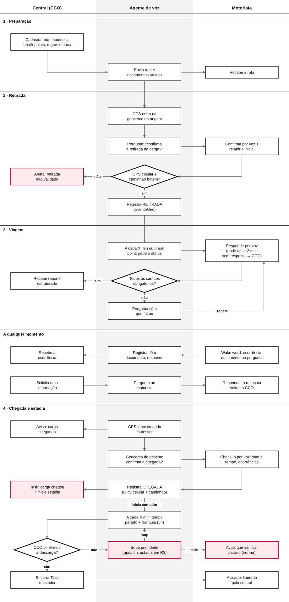

# Parceiro de Estrada — Problemas, causas e decisões

Respostas do time no quadro de revisão, atualizadas após a mentoria (ver [`ajustes-pos-mentoria.md`](ajustes-pos-mentoria.md)). Decididos: 16 · Descartados: 1 · Abertos: 0.

Quadro interativo: <https://claude.ai/artifact/CNY54DooqKRpEehXpXsaEW> · cópia local: [`revisao-fluxo.html`](revisao-fluxo.html) · fluxograma: [`fluxograma.svg`](fluxograma.svg)

| # | Área | Problema | Causa | Solução proposta | Decisão do time | Status |
|---|---|---|---|---|---|---|
| 1 | Fluxo | Escalonamento sem ação final definida | "Ficar parado" não dizia se é aguardar, não descarregar ou voltar | Regra configurável por transportadora (RegraEscalonamento); demo usa regra padrão mock | Segue a norma de cada transportadora | Decidido |
| 2 | LGPD | Dado de saúde passa por voz → Agora → LLM | A central já monitora, mas o canal é novo e envolve terceiros | Registrar a finalidade no termo do motorista; repassar só campos estruturados | Saúde sai do produto (não é o foco e evita dado sensível em canal novo). Ver `ajustes-pos-mentoria.md`, item 4.1. | Decidido |
| 3 | Documentos | IA pode errar número de NF, peso ou valor | LLM tende a aproximar ou inventar valores | Responder só com campos extraídos, citar o documento e dizer "não encontrei" | Como o usuario ja tem uma rota definida a central define os documentos entregues no app e interpretados pela IA. | Decidido |
| 4 | Segurança | Pergunta obrigatória no meio de uma manobra | Atualização é sempre necessária e o agente não sabe o momento | Permitir adiar até 2 min; sem resposta, escala para o CCO | Permitir adiar até 2 min; sem resposta, escala para o CCO | Decidido |
| 5 | Notificação | Re-notificar o CCO vira ruído | Repetir o mesmo canal não muda a atenção da central | Trocar de canal ao subir prioridade: push → destaque no painel → ligação/WhatsApp ao supervisor | Trocar de canal ao subir prioridade: push → destaque no painel → ligação(somente ligacao com a central) | Decidido |
| 6 | Fluxo | Avisar só na chegada perde antecedência | A Task era criada apenas no destino | Avisar na aproximação e criar a Task na chegada |  | Decidido |
| 7 | Fluxo | Motorista não sabe se o CCO confirmou | A confirmação fica só no painel | Agente avisa o motorista quando a Task for confirmada |  | Decidido |
| 8 | Estadia | Início da estadia pode ser contestado | A lei conta da chegada ao endereço; se o GPS falhar, não há prova | Geocerca do destino + check-in por voz + GPS do caminhão | Geocerca do destino + check-in por voz + GPS do caminhão | Decidido |
| 9 | Estadia | Contador de estadia sem fim definido | Não existe evento de "descarga concluída" | Motorista (voz) ou CCO confirma a descarga e encerra o contador | Motorista (voz) ou CCO confirma a descarga e encerra o contador | Decidido |
| 10 | Estadia | Franquia de 5h pode variar por contrato | Contratos podem prever outra franquia | franquia_h e valor por t/h configuráveis (valor atualizado pela ANTT) | franquia_h e valor por t/h configuráveis (valor atualizado pela ANTT) | Decidido |
| 11 | Prova | As duas provas de GPS vêm do mesmo lado | Celular e caminhão são da transportadora/motorista | Registro do destinatário: QR na portaria, assinatura ou canhoto | A resposta do recebedor na ligação do agente já registra o outro lado (ver `ajustes-pos-mentoria.md`, item 5). | Descartado |
| 12 | Prova | GPS do celular é falsificável | Apps de localização falsa | Rastreador do caminhão como prova forte; detectar mock location no Android | Rastreador do caminhão como prova forte; detectar mock location no Android | Decidido |
| 13 | Técnico | Localização em segundo plano | Android e iOS restringem; consumo de bateria | Foreground service + permissão "sempre" | Foreground service + permissão "sempre" | Decidido |
| 14 | Técnico | Sem sinal em trechos da rodovia | Cobertura celular irregular | Fila local de reportes e reenvio automático | Fila local de reportes e reenvio automático. StarLInk | Decidido |
| 15 | Técnico | Wake word falha em cabine ruidosa | Motor, rádio e vento | Medir falso acionamento; botão no volante como alternativa | Medir falso acionamento; botão no volante como alternativa | Decidido |
| 16 | IA | Reporte marcado como completo com resposta vaga | LLM aceita "tudo certo" como resposta para vários campos | Critério de aceite por campo obrigatório | Critério de aceite por campo obrigatório | Decidido |
| 17 | Fluxo | Recebedor só é avisado depois de 3 tentativas sem resposta do CCO | O fluxo avisava só o CCO na aproximação | Avisar o recebedor na aproximação | Avisar o recebedor na aproximação (condição para a estadia, segundo decisão da 3ª Turma Recursal do TJMT) | Decidido |
